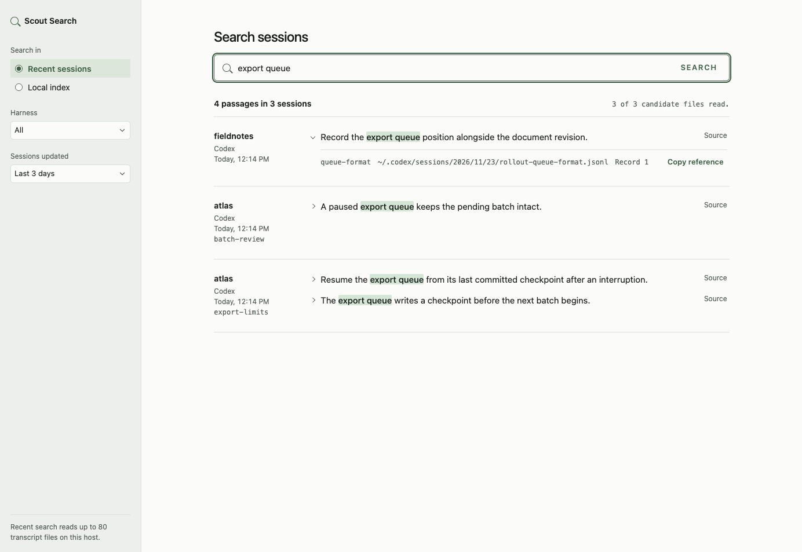

# Scout Search

Find the session where you discussed a change, ran a command or made a decision. Search reads Claude Code, Codex and Kimi transcripts on this host, including sessions started outside Scout. Expand a passage to see its session ID, transcript path and record range. **Copy reference** takes those coordinates back to your editor or agent.

## Run it

~~~sh
npx github:openscout-app/search
~~~

With Node 20 or newer, this opens Scout Search at http://127.0.0.1:4803. The launcher reuses an existing Scout Search server or tries the next available port. Add `--no-open` to skip the browser or `--port 4900` to choose a port. Stop the server with Ctrl+C.

## Recent sessions

Enter words from the passage you want. Search looks in up to 80 of the newest transcript files updated in the chosen window, three days by default. The reader looks for all query terms of two or more characters in the same record. The file scan has a 2.5-second budget and returns up to 30 passages, with up to three per file. The result includes how many candidate files it read. A miss covers only the history searched.

A recent search works with the local index off and the Scout runtime stopped. It reads transcripts in place. Queries and results stay on this host. The page listens on loopback and fetches its scripts, styles and results from the same address.

Agents and shell scripts can use the same search:

~~~sh
npx github:openscout-app/search query "export queue" --harness codex --hours 24
npx github:openscout-app/search query "export queue" --json
~~~

JSON includes the search mode, coverage and hits. Each hit includes a passage and its source coordinates when available. Record numbers use Scout's zero-based convention.

## Indexed history

Use **Local index** to search a window you have explicitly indexed. This mode uses the Scout CLI included in the package and requires Bun 1.4.4 or later. Set `SCOUT_BIN` to use a compatible Scout installation of your choice.

1. Turn on **Local search index** in Scout Settings › System, or set `knowledgeIndexEnabled` to `true` in Scout's existing `settings.json`.
2. Index the time window and any harness you want to search.
3. Select **Local index** in the browser, or pass `--mode index` to a terminal query.

~~~sh
npx github:openscout-app/search status
npx github:openscout-app/search index --hours 168 --harness claude
npx github:openscout-app/search query "export queue" --mode index --hours 168 --harness claude
~~~

Opening the page and running a query leave the index setting and its coverage alone. Search reports when indexing is off, a window needs indexing, or the retained history is stale or bounded. Scout manages the index and its storage cap.

## Development

~~~sh
npm ci
npm test
npm start
~~~

The standalone page uses HudsonKit controls. JSX-capable React apps can import
`PassageList` from `@openscout/search/passages` and its base styles from
`@openscout/search/passages.css`. Pass session groups with an `id`, a `header`,
and `passages`. Each passage has an `id` and excerpt `text`. Supply a
`reference` array of label/value pairs to expand and copy its source, or
`onSelect` and `onOpen` callbacks to use the app’s own session inspector.
The component renders the results you supply and makes no network requests.

The recent-session reader is built from the same public Scout release as the packaged CLI. To regenerate `vendor/recent.mjs`, run `scripts/build-reader.sh` with Bun 1.4.4. An optional path to an existing Scout Git checkout avoids a download. The script builds the pinned commit from Git objects.

Apache-2.0. See [LICENSE](LICENSE) and [NOTICE](NOTICE).
